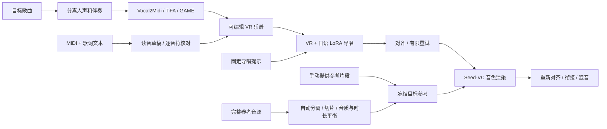

# UtaWeave · 歌织

**原曲，或 MIDI＋歌词 → 可编辑乐谱 → 指定音色的新演唱。**

UtaWeave 把 Vocal2Midi 自动标注、VocalRender 导唱与 Seed-VC 音色渲染连接起来，保存歌词、音符和原曲时间轴，再按唱句生成、对齐、有限重试及拼接整首歌曲。目前是**日语单主唱的实验基线**：完整流程已在本机跑通，复杂英文、误识别和片段衔接仍有改善空间。



## 当前版本

- 原曲自动转谱默认仅根据音频标注，不以参考罗马音、外部歌词或 LRC 替换识别结果；MIDI 入口则使用用户提供或获取的歌词文本。两者均支持页面核对，不包含逐曲手工改词规则。
- 日语采用 RomajiASR，英文采用 Qwen3-ASR；TiFA 对齐，GAME 提取音符。自动日英分流由本项目添加，依赖初次识别文本的文字类型，存在误判。
- 参考音色仅有两种入口：手动提供已剪好的片段，或从完整音源自动分离、分割，按 SingMOS 与有效人声时长平衡选择。两者均冻结并校验。
- VR 使用短唱句、原生停止预测，避免强制延长整曲生成。生成后对齐、最多两个候选重试、有限变速和衔接审计保留在结果目录。
- Seed-VC 固定原调原速；VR 导唱缓存与目标音色分开，换声后重新做音素对齐。
- 输出 48 kHz WAV 和 MP3：原曲时间轴人声、伴奏混音，以及保留原始生成速度的串联版 `natural`。
- 默认权重为 `ja-r64-e5`，Base LM / Residual LM / LocDiT LoRA 强度为 **1.0 / 1.0 / 0.5**。

本版本按阶段执行；尚未承诺任意歌曲的一条命令转换。歌曲获取不是运行前提，直接使用本地音频。已有网易云接口适配器需要用户自己配置 API bridge，不含登录凭据。

## 获取代码与权重

```bash
git clone https://github.com/zzzsl0815/UtaWeave.git
cd UtaWeave
git lfs install
git lfs pull
python scripts/bootstrap_upstreams.py
```

三个日语 LoRA 使用 Git LFS，合计约 290 MB；`weights/` 中的配置、模型说明和 SHA-256 随代码保存。VocalRender-Pro、ASR、TiFA、分离器等基础模型从上游获取，不重复放入 Git。上游源码固定在 [upstreams.lock.json](manifests/upstreams.lock.json)，运行资产记录在 [models.lock.json](manifests/models.lock.json)。

只需要检查代码时可先 `GIT_LFS_SKIP_SMUDGE=1 git clone ...`，稍后 `git lfs pull`。

## 安装与运行

实测基线为 Linux / Python 3.12 / CUDA PyTorch 2.8；完整推理需要 NVIDIA GPU。建议分别准备标注、分离评分、VR 渲染、Seed-VC 的 Python 环境，避免同名 `inference` 模块及依赖版本冲突。CPU 工具不需要安装神经模型依赖。

```bash
pip install -e '.[audio,dev]'
utaweave --help
python -m unittest discover -s tests -v
```

完整环境、模型布局和分阶段操作见 **[运行指南](docs/QUICKSTART.md)**。主要执行步骤如下，配置中路径需要按本机修改：

```bash
# 1. 准备目标歌曲的人声、伴奏和去混响人声
utaweave separate --audio inputs/target.flac \
  --runtime-config configs/reference_runtime.local.json --out runs/target

# 2. 自动平衡音质与时长，选取目标参考
utaweave prepare-reference --audio inputs/voice.flac \
  --runtime-config configs/reference_runtime.local.json --out runs/voice-reference
# 或手动提供已剪好的片段：
# utaweave prepare-reference --clip inputs/voice-clip.wav --out runs/voice-reference
# render 配置的 reference_run 可直接指向 runs/voice-reference。
# guide_reference_run 是 VR 固定提示；seed_vc_config 指向 Seed-VC 配置。

# 3. 标注目标人声，再用选定的参考生成
utaweave annotate --config configs/vocal2midi.local.json \
  --python .venv-labeling/bin/python
utaweave validate-conditioning runs/target-score/score.vr.json
utaweave render --config configs/render.local.json --out runs/render \
  --python .venv-render/bin/python
```

`render` 分别在配置的 VR、TiFA、Seed-VC 环境运行；上面的 `--python` 指定调度环境。`song2voice` 命令和 Python 包名保留兼容。

## 可视化工作台

提供两种输入：**网易云原曲／本地音频**，或 **MIDI＋歌词文本**。支持获取网易云歌词、选择旋律轨、查看音符、核对假名与一字多音、下载带歌词的 MIDI、准备目标音色、显示后台进度和最终试听。

```bash
.venv-svc/bin/pip install -e '.[ui]'
cp configs/web.example.json configs/web.local.json
# 填好模型、环境和可选网易云接口路径
.venv-svc/bin/utaweave serve --config configs/web.local.json --port 8770
```

打开 `http://127.0.0.1:8770/`，远程机器通过 SSH 端口转发访问。两种输入的具体操作、MIDI 歌词对应规则和边界见 **[可视化工作台指南](docs/WEB_UI.md)**。纯文本与 MIDI 无法唯一确定歌词对应，自动草稿需要核对。

## 权重与记录

当前试听优选 Seed-VC，主流程已收敛到这一后端。已生成的 VR 短句也可直接使用：

```bash
utaweave convert --config configs/seed_vc.local.json \
  --guide inputs/guide.wav --reference-run runs/voice-reference --out runs/converted
```

安装与复用方法见 [Seed-VC 音色渲染](docs/VOICE_CONVERSION.md)，两种参考方式及评分规则见 [参考准备](docs/REFERENCE_PREPARATION.md)。旧多后端和固定时长比较入口已移除。

| LoRA | 训练 | 用途 |
| --- | --- | --- |
| `ja-r64-e5` | r=64，alpha=128，第 5 轮，stop 系数 0.1 | 当前默认；日语演唱细节较好，LocDiT 建议先用 0.5 |
| `ja-r32-e45` | r=32，第 4.5 轮 | 上一轮试听对照 |
| `ja-r32-e5` | r=32，第 5 轮 | 上一轮试听对照；部分歌曲的音色听感更好 |

这些描述来自项目内试听，不是独立基准结论。音色参考、随机种子、乐谱和推理设置都会影响结果。详见 [模型说明](MODEL_CARD.md)、[训练记录](training/README.md)、[资产与下载](docs/MODELS.md)。

**本次发布只包含可用的 VR＋原生 Seed-VC 推理流水线。** 未通过试听验收的 latent 转换器、声学适配器和联合训练代码、配置及检查点不属于发布内容，也不会被推理命令加载。训练目录仅记录已发布 VR LoRA 的训练配方。

## 限制与后续方向

英文短句仍可能误听，正确语言分流也不保证正确发音；日语识别也会漏音或混淆。未知音高保留并标记。结构检查、输入覆盖和强制对齐通过，不能证明模型准确唱出了所有歌词。长唱句可能找不到安全切点，系统会报错，不会静默丢段。

2026-10-27 已完成测试集《マリーゴールド》的 308.107 秒整曲验证：26 个生成唱句、601 个乐谱歌词单元，导出 VR 与 Seed-VC 的混音、人声和原生逐句音频。70 项测试在主运行环境及标注环境中通过。仍保留未知音高、极短元音膨胀和疑似尾奏误识别等质量问题；这不是人工校对乐谱或听感认证。数值结果与限制见 [整曲验证记录](manifests/full-song-verification.json)。

2026-11-05 发布整理验证包括 80 项自动测试、MIDI＋歌词与原曲短片段的真实 GPU 推理、网易云完整音频和歌词获取，以及桌面/窄屏浏览器播放、跳转和音轨切换。范围与限制见 [本次发布验证](manifests/release-verification.json)。旧试听和失败融合训练产物已清理，历史数值记录保留。

后续优先改善英文完整乐句识别、混合语言处理、音符与音节对应、呼吸衔接和复现环境。旧参考歌词优先转谱、英文转日式拼写、推断补音高及人工候选选择的未使用分支已移除；历史方案保留在历史文档中。

本仓库保存代码、配置、少量自造测试输入和选定 LoRA。原始歌曲、下载歌词、参考人声、训练录音、生成音频、优化器状态、Cookie、SSH 私钥及本机路径配置均不上传。

## 致谢与许可

感谢 [VocalRender](https://github.com/pymaster17/VocalRender)、[Vocal2Midi](https://github.com/Xiantaidu/Vocal2Midi)、[RomajiASR](https://github.com/Xiantaidu/RomajiASR)、[TiFA](https://github.com/openvpi/TIFA)、[GAME](https://github.com/openvpi/GAME)、[Qwen3-ASR](https://github.com/QwenLM/Qwen3-ASR)、[SingMOS](https://github.com/South-Twilight/SingMOS) 、[Seed-VC](https://github.com/Plachtaa/seed-vc) 和 [SingCrawl](https://github.com/pymaster17/SingCrawl)。

本项目自写代码采用 [Apache-2.0](LICENSE)。第三方源码、字典、模型、训练录音和输出各自遵循对应条款；详见 [第三方说明](THIRD_PARTY_NOTICES.md)。
