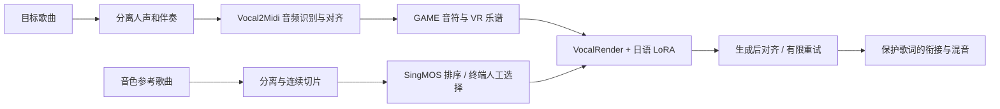

# UtaWeave · 歌织

**歌曲 → 可编辑乐谱 → 指定音色的新演唱。**

UtaWeave 把 Vocal2Midi 自动标注与 VocalRender 歌声合成连接起来，保存歌词、音符和原曲时间轴，再按唱句生成、对齐、有限重试及拼接整首歌曲。目前是**日语单主唱的实验基线**：完整流程已在本机跑通，复杂英文、误识别和片段衔接仍有改善空间。



## 当前版本

- 默认仅根据音频标注，**不读取参考罗马音、外部歌词或 LRC**，不包含逐曲手工改词规则。
- 日语采用 RomajiASR，英文采用 Qwen3-ASR；TiFA 对齐，GAME 提取音符。自动日英分流由本项目添加，依赖初次识别文本的文字类型，存在误判。
- 音色候选在终端显示原曲时间、时长及 SingMOS 分数；用户选定后冻结参考。无需网页。
- VR 使用短唱句、原生停止预测，避免强制延长整曲生成。生成后对齐、最多两个候选重试、有限变速和衔接审计保留在结果目录。
- 输出 48 kHz WAV 和 MP3：原曲时间轴人声、伴奏混音，以及保留原始生成速度的串联版 `natural`。
- 默认权重为 `ja-r64-e5`，Base LM / Residual LM / LocDiT LoRA 强度为 **1.0 / 1.0 / 0.5**。

本版本按阶段执行；尚未承诺任意歌曲的一条命令转换。歌曲获取不是运行前提，直接使用本地音频。已有网易云接口适配器需要用户自己配置 API bridge，不含登录凭据。

## 获取代码与权重

```bash
git clone https://github.com/zzzsl0815/UtaWeave.git
cd UtaWeave
git lfs install
git lfs pull
python scripts/bootstrap_upstreams.py
```

三个日语 LoRA 使用 Git LFS，合计约 290 MB；`weights/` 中的配置、模型说明和 SHA-256 随代码保存。VocalRender-Pro、ASR、TiFA、分离器等基础模型从上游获取，不重复放入 Git。上游源码固定在 [upstreams.lock.json](manifests/upstreams.lock.json)，运行资产记录在 [models.lock.json](manifests/models.lock.json)。

只需要检查代码时可先 `GIT_LFS_SKIP_SMUDGE=1 git clone ...`，稍后 `git lfs pull`。

## 安装与运行

实测基线为 Linux / Python 3.12 / CUDA PyTorch 2.8；完整推理需要 NVIDIA GPU。建议分离标注、分离评分、VR 渲染的 Python 环境，避免同名 `inference` 模块及依赖版本冲突。CPU 工具不需要安装神经模型依赖。

```bash
pip install -e '.[audio]'
utaweave --help
python -m unittest discover -s tests -v
```

完整环境、模型布局和分阶段操作见 **[运行指南](docs/QUICKSTART.md)**。三个主要执行步骤如下，配置中路径需要按本机修改：

```bash
# 1. 准备目标歌曲的人声、伴奏和去混响人声
utaweave separate --audio inputs/target.flac \
  --runtime-config configs/reference_runtime.local.json --out runs/target

# 2. 从另一个音源生成音色候选，在终端选择
utaweave prepare-reference --audio inputs/voice.flac \
  --runtime-config configs/reference_runtime.local.json --out runs/voice-reference

# 3. 标注目标人声，再用选定的参考生成
utaweave annotate --config configs/vocal2midi.local.json \
  --python .venv-labeling/bin/python
utaweave validate-conditioning runs/target-score/score.vr.json
utaweave render --config configs/render.local.json --out runs/render \
  --python .venv-render/bin/python
```

`render` 的两个 Python 路径来自配置，分别执行 VR 与 TiFA；上面的 `--python` 指定调度环境。`song2voice` 命令和 Python 包名保留兼容。

## 权重与记录

| LoRA | 训练 | 用途 |
| --- | --- | --- |
| `ja-r64-e5` | r=64，alpha=128，第 5 轮，stop 系数 0.1 | 当前默认；日语演唱细节较好，LocDiT 建议先用 0.5 |
| `ja-r32-e45` | r=32，第 4.5 轮 | 上一轮试听对照 |
| `ja-r32-e5` | r=32，第 5 轮 | 上一轮试听对照；部分歌曲的音色听感更好 |

这些描述来自项目内试听，不是独立基准结论。音色参考、随机种子、乐谱和推理设置都会影响结果。详见 [模型说明](MODEL_CARD.md)、[训练记录](training/README.md)、[资产与下载](docs/MODELS.md)。

## 限制与后续方向

英文短句仍可能误听，正确语言分流也不保证正确发音；日语识别也会漏音或混淆。未知音高保留并标记。结构检查、输入覆盖和强制对齐通过，不能证明模型准确唱出了所有歌词。长唱句可能找不到安全切点，系统会报错，不会静默丢段。

后续优先改善英文完整乐句识别、混合语言处理、音符与音节对应、呼吸衔接和复现环境。历史参考罗马音修复、旧模型拼写适配及旧转谱实验保留在代码/历史文档中，**不参与默认路径**。

本仓库保存代码、配置、少量自造测试输入和选定 LoRA。原始歌曲、下载歌词、参考人声、训练录音、生成音频、优化器状态、Cookie、SSH 私钥及本机路径配置均不上传。

## 致谢与许可

感谢 [VocalRender](https://github.com/pymaster17/VocalRender)、[Vocal2Midi](https://github.com/Xiantaidu/Vocal2Midi)、[RomajiASR](https://github.com/Xiantaidu/RomajiASR)、[TiFA](https://github.com/openvpi/TIFA)、[GAME](https://github.com/openvpi/GAME)、[Qwen3-ASR](https://github.com/QwenLM/Qwen3-ASR)、[SingMOS](https://github.com/South-Twilight/SingMOS) 和 [SingCrawl](https://github.com/pymaster17/SingCrawl)。

本项目自写代码采用 [Apache-2.0](LICENSE)。第三方源码、字典、模型、训练录音和输出各自遵循对应条款；详见 [第三方说明](THIRD_PARTY_NOTICES.md)。
